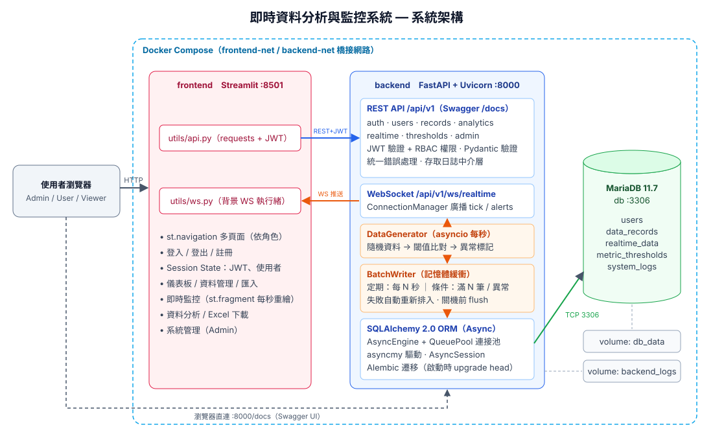

# 📡 即時資料分析與監控系統（Realtime Monitor）

以 **FastAPI + WebSocket + MariaDB + Streamlit** 打造的即時資料分析與監控平台，全部以 **Docker Compose** 容器化部署。

- 後端提供 RESTful API（JWT 認證、RBAC 權限）與 WebSocket 即時推送
- 模擬器每秒產生感測資料，超過閾值即時告警，並以「定期 + 條件觸發」批次寫入 MariaDB
- 前端為多頁面 Streamlit 應用：即時圖表、資料 CRUD / 匯入、統計分析與 Excel 下載、系統管理



> 更多架構說明（元件圖、即時資料時序圖、ER 圖）：[docs/architecture.md](docs/architecture.md)

---

## 目錄

- [功能總覽](#功能總覽)
- [技術棧](#技術棧)
- [專案結構](#專案結構)
- [快速開始（Docker）](#快速開始docker)
- [本地運行（不使用 Docker）](#本地運行不使用-docker)
- [測試帳號](#測試帳號)
- [API 文件](#api-文件)
- [權限設計](#權限設計)
- [即時資料與批次寫入](#即時資料與批次寫入)
- [測試資料（CSV / JSON）](#測試資料csv--json)
- [環境變數](#環境變數)
- [測試](#測試)
- [常用 Docker 指令](#常用-docker-指令)

---

## 功能總覽

| 模組 | 功能 |
|---|---|
| **使用者管理** | 註冊、登入（JWT）、登出、個人資料 / 密碼修改；角色 `admin` / `user` / `viewer` 與權限控制 |
| **資料管理** | 新增記錄（標題、數值、分類、時間戳、描述）；分頁、篩選（分類、時間、數值範圍、關鍵字、建立者、異常）、排序；更新 / 刪除僅限建立者或 Admin；CSV / JSON 批量匯入（逐列驗證並回報錯誤列） |
| **即時監控** | 每秒產生 4 種指標的隨機資料；WebSocket 推送；前端即時折線圖、柱狀圖；超過閾值標記異常並跳出告警 |
| **資料分析** | 統計（筆數、總計、平均、最大、最小、異常數）；時間範圍查詢；分類聚合；趨勢圖（小時 / 日 / 月）；**下載 Excel**（Summary / By Category / Trend / Records 四個工作表）；即時資料的指標統計與分鐘趨勢 |
| **系統管理（Admin）** | 使用者列表與權限 / 啟用狀態管理；系統日誌查詢（等級、類別、使用者、關鍵字、時間）；資料庫狀態監控（版本、延遲、連接池、各表筆數）；即時資料歷史查詢（含圖表與 CSV 下載）；告警閾值設定；產生器啟動 / 停止 / 手動寫入 |

## 技術棧

| 層級 | 技術 | 說明 |
|---|---|---|
| 後端框架 | **FastAPI 0.115** + Uvicorn | 全非同步（async/await）、自動產生 Swagger / ReDoc |
| 資料驗證 | **Pydantic v2** / pydantic-settings | Request / Response schema、環境變數設定 |
| 認證 | **PyJWT** + bcrypt | OAuth2 Password Flow 取得 JWT，Bearer Token 驗證 |
| 即時通訊 | **WebSocket**（Starlette） | 連線時以 `?token=` 驗證，支援訂閱指定指標 |
| ORM | **SQLAlchemy 2.0（AsyncIO）** | 所有 DB 操作皆以 ORM 完成，**無原生 SQL** |
| DB 驅動 | **asyncmy** | MariaDB / MySQL 非同步驅動 |
| 資料庫 | **MariaDB 11.7** | utf8mb4、named volume 持久化 |
| 遷移 | **Alembic**（async env） | 容器啟動時自動 `upgrade head` |
| 前端 | **Streamlit 1.41** + Plotly + Pandas | `st.navigation` 多頁面、`st.fragment(run_every=…)` 即時重繪 |
| 前端 WS 用戶端 | websocket-client | 背景執行緒接收推送、自動重連 |
| Excel | openpyxl | 後端產生 .xlsx 串流下載 |
| 容器化 | Docker 多階段建置 + Docker Compose | 3 個服務、2 個橋接網路、2 個 volume |
| 測試 | pytest + FastAPI TestClient（SQLite） | 17 個整合測試，涵蓋認證、權限、CRUD、匯入、分析、WebSocket、批次寫入 |

## 專案結構

```
realtime-monitor/
├── backend/
│   ├── Dockerfile                # 多階段建置（builder → runtime）
│   ├── entrypoint.sh             # 等待 DB → alembic upgrade head → uvicorn
│   ├── alembic.ini
│   ├── alembic/                  # async 遷移環境 + versions/
│   ├── requirements.txt / requirements-dev.txt
│   ├── app/
│   │   ├── main.py               # App、lifespan、CORS、存取日誌中介層、/health
│   │   ├── core/                 # config、security(JWT)、permissions(RBAC)、deps、exceptions、logging
│   │   ├── db/                   # Base、AsyncEngine 與連接池、Session
│   │   ├── models/               # User、DataRecord、RealtimeData、MetricThreshold、SystemLog
│   │   ├── schemas/              # Pydantic schemas
│   │   ├── api/v1/               # auth、users、records、analytics、realtime(+ws)、thresholds、admin
│   │   └── services/             # generator、batch_writer、ws_manager、importer、seed、audit、thresholds
│   └── tests/
├── frontend/
│   ├── Dockerfile                # 多階段建置
│   ├── app.py                    # 進入點：依登入狀態 / 角色組成導覽
│   ├── views/                    # login、dashboard、realtime、records、analytics、admin、profile
│   └── utils/                    # api 用戶端、auth（session state）、ws 背景連線
├── sample_data/
│   ├── records.csv               # 300 筆範例資料（首次啟動自動匯入）
│   ├── records.json              # JSON 匯入範例
│   └── records_with_errors.csv   # 含錯誤列，展示匯入驗證
├── docs/
│   ├── architecture.svg          # 系統架構圖
│   └── architecture.md           # 元件圖 / 時序圖 / ER 圖（Mermaid）
├── docker-compose.yml
├── .env.example
└── README.md
```

## 快速開始（Docker）

**需求**：Docker 24+、Docker Compose v2

```bash
git clone https://github.com/<your-account>/realtime-monitor.git
cd realtime-monitor

# 1. 建立環境變數檔（正式環境請務必修改密碼與 JWT_SECRET_KEY）
cp .env.example .env

# 2. 建置並啟動（db → backend → frontend，依 healthcheck 依序啟動）
docker compose up -d --build

# 3. 查看狀態 / 日誌
docker compose ps
docker compose logs -f backend
```

啟動完成後：

| 服務 | 網址 |
|---|---|
| 前端（Streamlit） | http://localhost:8501 |
| API 文件（Swagger UI） | http://localhost:8000/docs |
| API 文件（ReDoc） | http://localhost:8000/redoc |
| OpenAPI JSON | http://localhost:8000/openapi.json |
| 健康檢查 | http://localhost:8000/health |
| MariaDB | `localhost:3306`（帳密見 `.env`） |

> Port 衝突時，修改 `.env` 中的 `FRONTEND_PORT` / `BACKEND_PORT` / `DB_EXPOSE_PORT` 即可。

首次啟動時後端會自動：執行 Alembic 遷移 → 建立 3 個測試帳號 → 建立預設告警閾值 → 匯入 `sample_data/records.csv`（資料表為空時）→ 啟動即時資料產生器。

## 本地運行（不使用 Docker）

**需求**：Python 3.12、MariaDB 11.7（可只用 Docker 啟動 DB）

```bash
cp .env.example .env
# 只啟動資料庫
docker compose up -d db
```

**後端**

```bash
cd backend
python -m venv .venv && source .venv/bin/activate
pip install -r requirements-dev.txt
alembic upgrade head                       # 建立資料表（讀取 ../.env 的 DB_* 設定）
uvicorn app.main:app --reload --port 8000
```

**前端**（另開終端機）

```bash
cd frontend
python -m venv .venv && source .venv/bin/activate
pip install -r requirements.txt
API_BASE_URL=http://localhost:8000 streamlit run app.py
```

開啟 http://localhost:8501 。

## 測試帳號

首次啟動自動建立（密碼可於 `.env` 調整）：

| 角色 | 帳號 | 密碼 | 可執行操作 |
|---|---|---|---|
| Admin | `admin` | `Admin@123` | 全部功能，含系統管理 |
| User | `user` | `User@123` | 檢視、新增、匯入、修改 / 刪除自己的資料 |
| Viewer | `viewer` | `Viewer@123` | 唯讀（檢視、分析、即時監控、下載 Excel） |

新註冊的帳號預設為 `user`，Admin 可在「系統管理 → 使用者」調整角色或停用帳號。

## API 文件

- **Swagger UI**：http://localhost:8000/docs（點右上角 **Authorize** 輸入帳密即可直接測試）
- **ReDoc**：http://localhost:8000/redoc

所有 API 皆位於 `/api/v1`，錯誤回應統一格式：

```json
{ "error": { "code": "FORBIDDEN", "message": "Only the creator or an admin can modify this record", "details": null } }
```

### 端點一覽

| 方法 | 路徑 | 說明 | 權限 |
|---|---|---|---|
| POST | `/auth/register` | 註冊 | 公開 |
| POST | `/auth/login` | 登入取得 JWT（form-data） | 公開 |
| POST | `/auth/logout` | 登出（記錄事件） | 登入 |
| GET | `/auth/me` | 目前使用者 | 登入 |
| GET / PATCH | `/users/me` | 個人資料 / 修改 | 登入 |
| GET | `/users/me/permissions` | 角色權限清單 | 登入 |
| GET | `/users` | 使用者列表（搜尋、角色、分頁） | Admin |
| GET / PATCH / DELETE | `/users/{id}` | 取得 / 調整角色與狀態 / 刪除 | Admin |
| GET | `/records` | 列表：`page,size,sort_by,order,category,start,end,min_value,max_value,keyword,owner_id,is_anomaly` | 全部角色 |
| POST | `/records` | 新增 | Admin / User |
| GET | `/records/categories` | 分類清單 | 全部角色 |
| GET | `/records/{id}` | 單筆 | 全部角色 |
| PUT / PATCH | `/records/{id}` | 完整 / 部分更新 | 建立者或 Admin |
| DELETE | `/records/{id}` | 刪除 | 建立者或 Admin |
| POST | `/records/import` | CSV / JSON 批量匯入（multipart `file`） | Admin / User |
| GET | `/analytics/summary` | 總計 / 平均 / 最大 / 最小 / 異常數 | 全部角色 |
| GET | `/analytics/by-category` | 分類聚合 | 全部角色 |
| GET | `/analytics/trend` | 趨勢（`interval=minute/hour/day/month`） | 全部角色 |
| GET | `/analytics/export` | 下載 Excel | 全部角色 |
| GET | `/analytics/realtime/summary` | 即時資料各指標統計 | 全部角色 |
| GET | `/analytics/realtime/trend` | 即時資料時間分桶趨勢 | 全部角色 |
| GET | `/realtime/status` | 產生器 / 批次寫入器狀態 | 全部角色 |
| GET | `/realtime/latest` | 記憶體中最近資料 | 全部角色 |
| POST | `/realtime/generator/start` · `/stop` | 啟動 / 停止產生器 | Admin |
| POST | `/realtime/flush` | 立即批次寫入 | Admin |
| GET | `/realtime/history` | 即時資料歷史查詢 | Admin |
| WS | `/ws/realtime?token=<JWT>&metrics=a,b` | 即時推送 | 全部角色 |
| GET | `/thresholds` | 閾值列表 | 登入 |
| PUT / DELETE | `/thresholds/{name}` | 新增或更新 / 刪除閾值 | Admin |
| GET | `/admin/logs` | 系統日誌查詢 | Admin |
| GET | `/admin/db-status` | 資料庫狀態 | Admin |

### 範例

```bash
# 登入
TOKEN=$(curl -s -X POST http://localhost:8000/api/v1/auth/login \
  -d "username=user&password=User@123" | python -c "import sys,json;print(json.load(sys.stdin)['access_token'])")

# 查詢：sales 分類、數值由大到小、第 1 頁
curl -s "http://localhost:8000/api/v1/records?category=sales&sort_by=value&order=desc&page=1&size=5" \
  -H "Authorization: Bearer $TOKEN"

# 匯入 CSV
curl -s -X POST http://localhost:8000/api/v1/records/import \
  -H "Authorization: Bearer $TOKEN" -F "file=@sample_data/records_with_errors.csv"

# 下載 Excel
curl -s -o report.xlsx "http://localhost:8000/api/v1/analytics/export?start=2026-09-01T00:00:00" \
  -H "Authorization: Bearer $TOKEN"
```

### WebSocket 訊息格式

```jsonc
// 連線後
{"type": "snapshot", "points": [ ... ]}
// 每秒
{"type": "tick",
 "points": [{"metric": "temperature", "value": 26.4, "threshold": 35.0, "is_anomaly": false, "timestamp": "2026-10-23T12:00:01"}, ...],
 "alerts": [ /* 本次超過閾值的點 */ ]}
// 客戶端可送出
{"action": "subscribe", "metrics": ["temperature", "cpu_usage"]}
{"action": "ping"}
```

## 權限設計

角色與權限對照定義於 [`backend/app/core/permissions.py`](backend/app/core/permissions.py)，API 以 `Depends(require_perm(...))` 檢查，資料修改再額外檢查「是否為建立者」。

| 功能 | Admin | User | Viewer |
|---|:-:|:-:|:-:|
| 檢視資料 / 分析 / 即時監控 / 下載 Excel | ✅ | ✅ | ✅ |
| 新增資料 / 批量匯入 | ✅ | ✅ | ❌ |
| 修改 / 刪除**自己**的資料 | ✅ | ✅ | ❌ |
| 修改 / 刪除**他人**的資料 | ✅ | ❌ | ❌ |
| 使用者管理、系統日誌、DB 狀態、即時歷史、閾值、產生器控制 | ✅ | ❌ | ❌ |

前端導覽也依角色顯示：非 Admin 看不到「系統管理」頁，Viewer 的新增 / 編輯 / 匯入區塊會停用。

## 即時資料與批次寫入

1. `DataGenerator`（asyncio 背景任務）每 `GENERATOR_INTERVAL_SECONDS` 秒為 `REALTIME_METRICS` 各產生一筆資料（均值回歸隨機漫步，約 3% 機率突波）。
2. 與 `metric_thresholds` 比對，`value > threshold` 即 `is_anomaly=true`，並寫入告警日誌。
3. 透過 `ConnectionManager` 以 WebSocket 廣播給所有已連線的客戶端。
4. 資料進入 `BatchWriter` 記憶體緩衝，以 ORM `add_all()` 批次寫入 `realtime_data`：
   - **定期觸發**：每 `BATCH_FLUSH_INTERVAL_SECONDS` 秒
   - **條件觸發**：緩衝區達 `BATCH_MAX_SIZE` 筆，或出現異常值（`FLUSH_ON_ANOMALY=true`）
   - **關機 / 停止產生器**時寫入剩餘資料；DB 寫入失敗會重新排回緩衝區
5. 前端以背景執行緒維持 WebSocket 連線，`st.fragment(run_every=1s)` 每秒重繪折線圖（含閾值線與異常標記）、最新值 / 閾值柱狀圖、異常次數柱狀圖與告警列表。

`/realtime/status` 或「儀表板」可看到已產生 / 已寫入數量、緩衝區大小，以及最後一次寫入的觸發原因（`interval` / `size` / `anomaly` / `manual`）。

## 測試資料（CSV / JSON）

| 檔案 | 說明 |
|---|---|
| [`sample_data/records.csv`](sample_data/records.csv) | 300 筆，5 種分類（temperature / humidity / cpu_usage / sales / traffic），2026-08-25 起 60 天，約 7% 超過閾值。首次啟動自動匯入（`SEED_SAMPLE_DATA=true`） |
| [`sample_data/records.json`](sample_data/records.json) | JSON 匯入格式範例（`{"records": [...]}`） |
| [`sample_data/records_with_errors.csv`](sample_data/records_with_errors.csv) | 含格式錯誤列，展示逐列驗證與錯誤回報 |

CSV 欄位：

```csv
title,value,category,timestamp,description
Sensor-A 溫度,26.4,temperature,2026-10-01T08:00:00,morning reading
```

`title`、`value`、`category` 必填；`timestamp` 省略時使用匯入時間；支援 UTF-8（含 BOM）。

## 環境變數

完整清單與說明見 [`.env.example`](.env.example)，重點如下：

| 變數 | 預設 | 說明 |
|---|---|---|
| `MARIADB_ROOT_PASSWORD` / `DB_PASSWORD` | – | **必填**，資料庫密碼 |
| `DB_NAME` / `DB_USER` | `monitor` | 資料庫 / 使用者 |
| `DB_POOL_SIZE` / `DB_MAX_OVERFLOW` / `DB_POOL_RECYCLE` | 10 / 20 / 1800 | SQLAlchemy 連接池 |
| `JWT_SECRET_KEY` | – | **正式環境務必更換** |
| `ACCESS_TOKEN_EXPIRE_MINUTES` | 120 | Token 有效時間 |
| `ADMIN_PASSWORD` / `DEMO_USER_PASSWORD` / `DEMO_VIEWER_PASSWORD` | 見測試帳號 | 預設帳號密碼 |
| `GENERATOR_ENABLED` / `GENERATOR_INTERVAL_SECONDS` | true / 1 | 即時資料產生器 |
| `BATCH_FLUSH_INTERVAL_SECONDS` / `BATCH_MAX_SIZE` / `FLUSH_ON_ANOMALY` | 10 / 50 / true | 批次寫入觸發條件 |
| `THRESHOLDS` / `DEFAULT_THRESHOLD` | JSON / 90 | 初始告警閾值 |
| `BACKEND_PORT` / `FRONTEND_PORT` / `DB_EXPOSE_PORT` | 8000 / 8501 / 3306 | 對外 Port |

## 測試

```bash
cd backend
pip install -r requirements-dev.txt
pytest
```

測試以 SQLite（aiosqlite）取代 MariaDB，程式碼路徑同樣全部經由 SQLAlchemy ORM，涵蓋：

- 註冊 / 登入 / Token 驗證 / 統一錯誤格式
- 三種角色的權限邊界、建立者限制
- 分頁、篩選、排序；CSV / JSON 匯入與錯誤列回報
- 統計、分類聚合、趨勢、Excel 匯出內容
- Admin 端點、角色變更、停用帳號、閾值
- WebSocket 認證 / 訂閱 / ping、產生器 → 批次寫入 → 歷史查詢

## 常用 Docker 指令

```bash
docker compose up -d --build          # 建置並啟動
docker compose ps                     # 狀態（含 healthcheck）
docker compose logs -f backend        # 後端日誌
docker compose exec backend alembic current          # 目前遷移版本
docker compose exec db mariadb -umonitor -p monitor  # 進入資料庫
docker compose restart backend        # 重啟後端
docker compose down                   # 停止（保留資料）
docker compose down -v                # 停止並刪除 volume（清空資料庫）
```

| 項目 | 說明 |
|---|---|
| 多階段建置 | `builder` 階段建立 venv 並編譯相依套件，`runtime` 階段只複製 venv 與程式碼，以非 root 使用者執行 |
| 網路 | `frontend-net`（frontend ↔ backend）、`backend-net`（backend ↔ db），frontend 無法直接存取資料庫 |
| Volume | `db_data`（MariaDB 資料）、`backend_logs`（輪替日誌檔） |
| 啟動順序 | `depends_on: condition: service_healthy`，db → backend → frontend |
