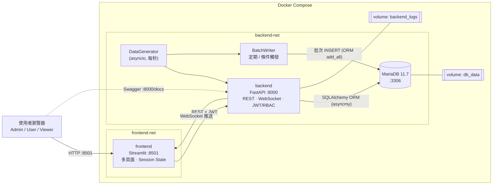
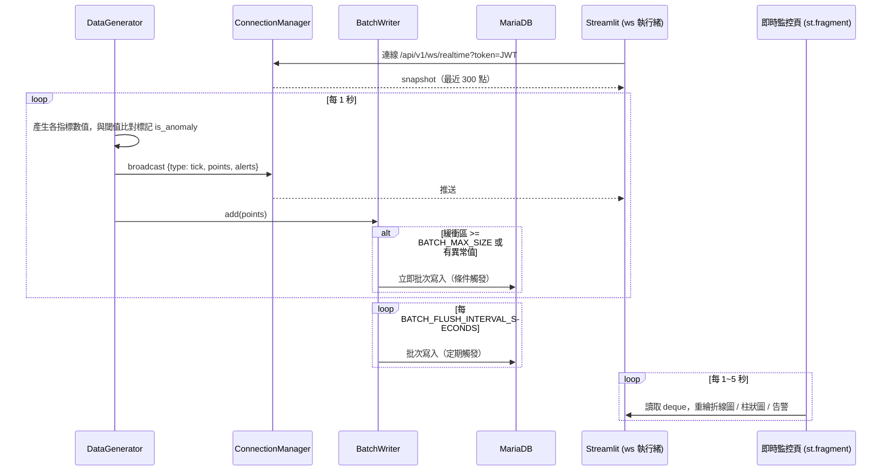
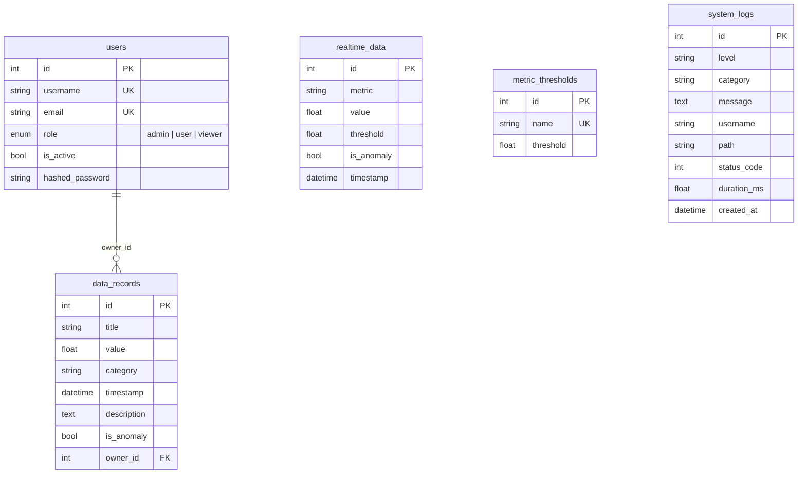

# 系統架構

## 元件關係

## 即時資料流程

## 資料模型

## 設計重點

| 主題 | 做法 |
|---|---|
| ORM | 所有查詢、聚合、時間分桶皆以 SQLAlchemy 2.0 `select()` / `func.*` 表達，無原生 SQL 字串 |
| 非同步 | `create_async_engine("mysql+asyncmy://...")` + `AsyncSession`；API、產生器、批次寫入全為 async |
| 連接池 | `pool_size`、`max_overflow`、`pool_recycle`、`pool_pre_ping` 皆由環境變數控制，`/admin/db-status` 可即時觀察 |
| 遷移 | Alembic（async env），容器啟動時 `alembic upgrade head` |
| 批次寫入 | 記憶體緩衝；定期（每 N 秒）、條件（滿 N 筆 / 出現異常）、關機前 flush；DB 失敗時重新排入 |
| 權限 | Role → Permission 對照表（`app/core/permissions.py`），以 `require_perm()` 依賴注入檢查；資料修改另檢查擁有者 |
| 日誌 | stdout + 輪替檔（`backend_logs` volume）+ `system_logs` 表（存取 / 認證 / 資料異動 / 告警） |
| 擴展性 | 產生器與 WS 管理為行程內單例，故 uvicorn 以單一 worker 執行；如需水平擴展，可將產生器獨立成服務並以 Redis Pub/Sub 廣播 |
